# Spillway

Alerts on the wind and solar energy Brazil's grid operator keeps from being generated, built for [the ONS's open curtailment data](https://dados.ons.org.br).

Spillway reads the ONS's files every hour and shows what was curtailed: a day, a week or a month against the one before, the plants that lost the most, and every month since the data begins. An account keeps up to twenty alerts, each a daily limit on one source in one subsystem: tell me when more than 150,000 MWh of Northeast wind goes unused in a day. Before an alert is saved, a chart shows the days of the last thirty it would have fired on.

SvelteKit 3 and Svelte 5 in front, a Go 1.27 API behind it, Postgres 18 behind that, and an OpenAPI 3.1 contract between the two servers that both are generated from.

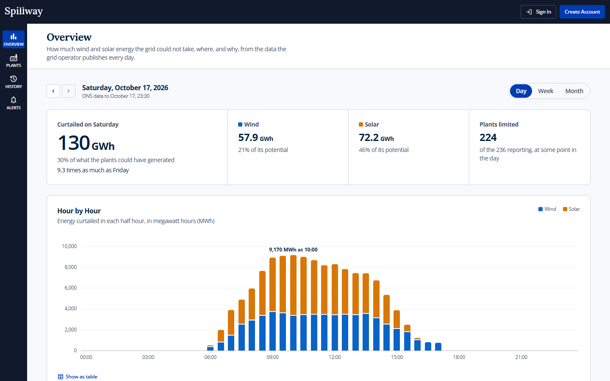

<details>
<summary>More screens</summary>

**A half hour, pointed at**

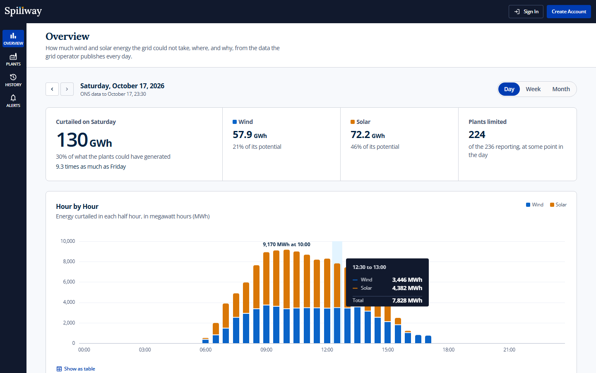

**A month so far**

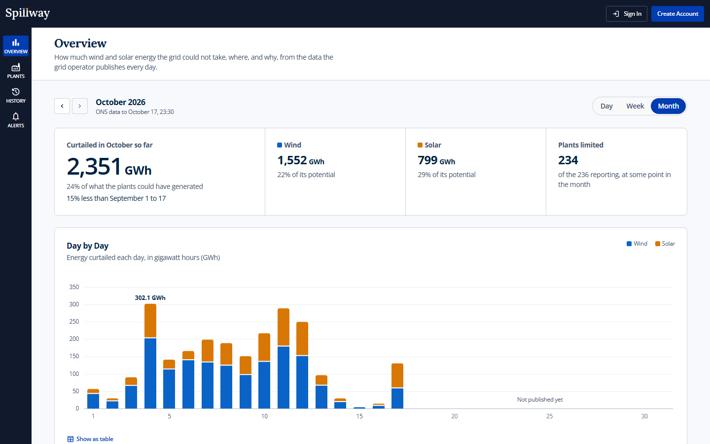

**The plants, ranked**

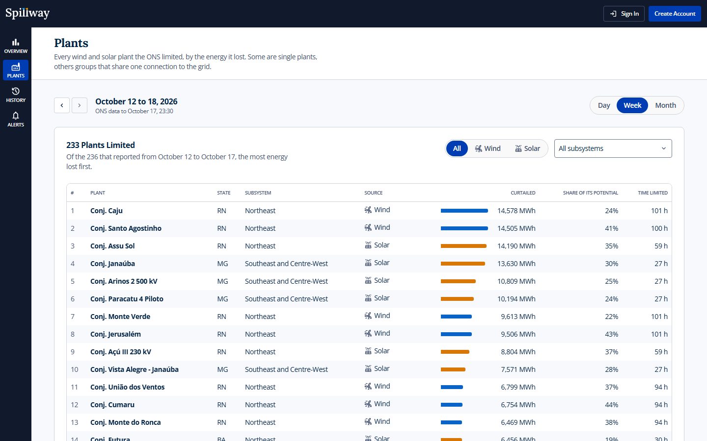

**Every month since the data begins**

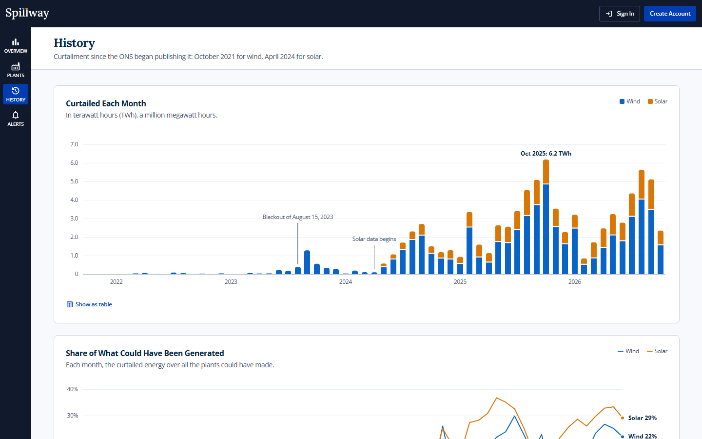

**The alerts, and the days they fired**

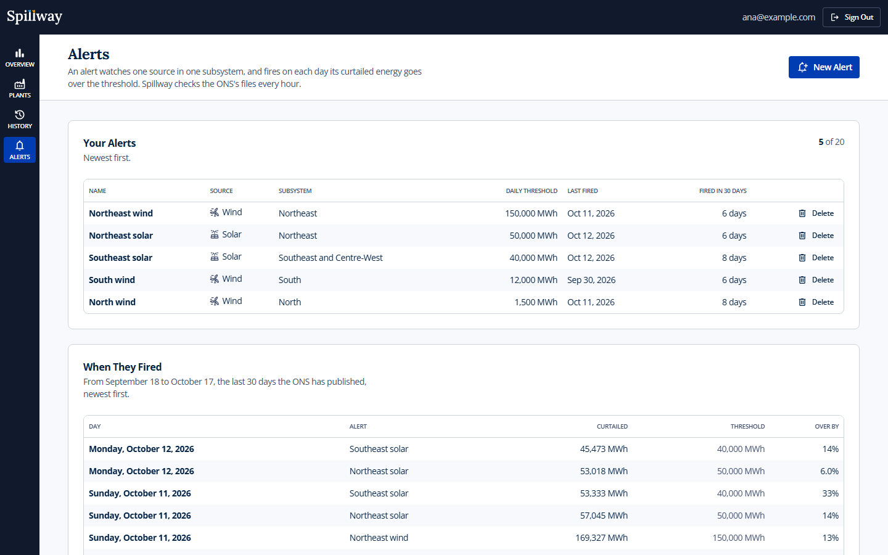

**A new alert, against the last 30 days**

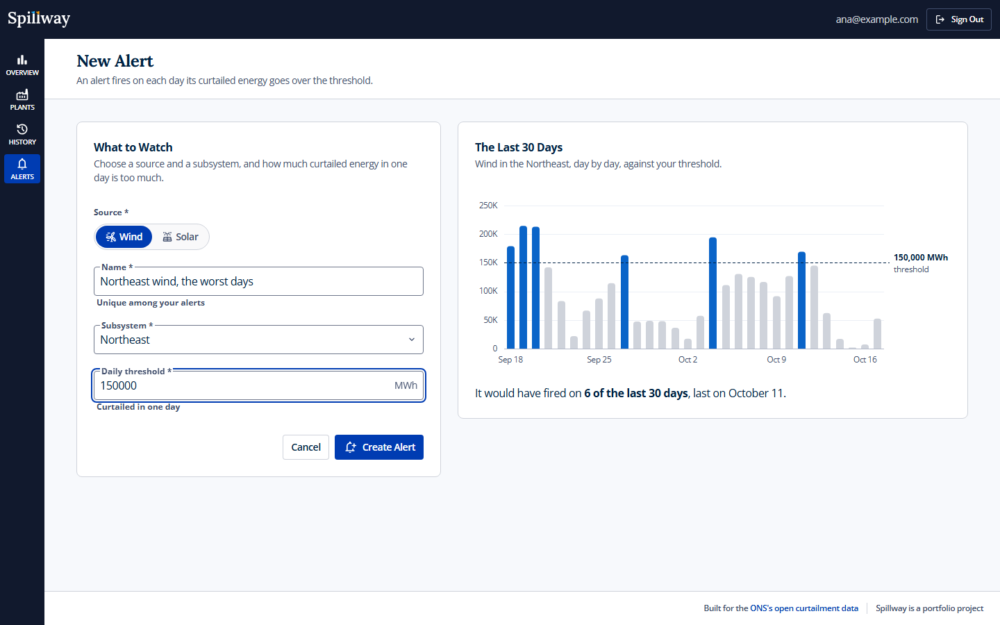

**A form refused, with or without JavaScript**

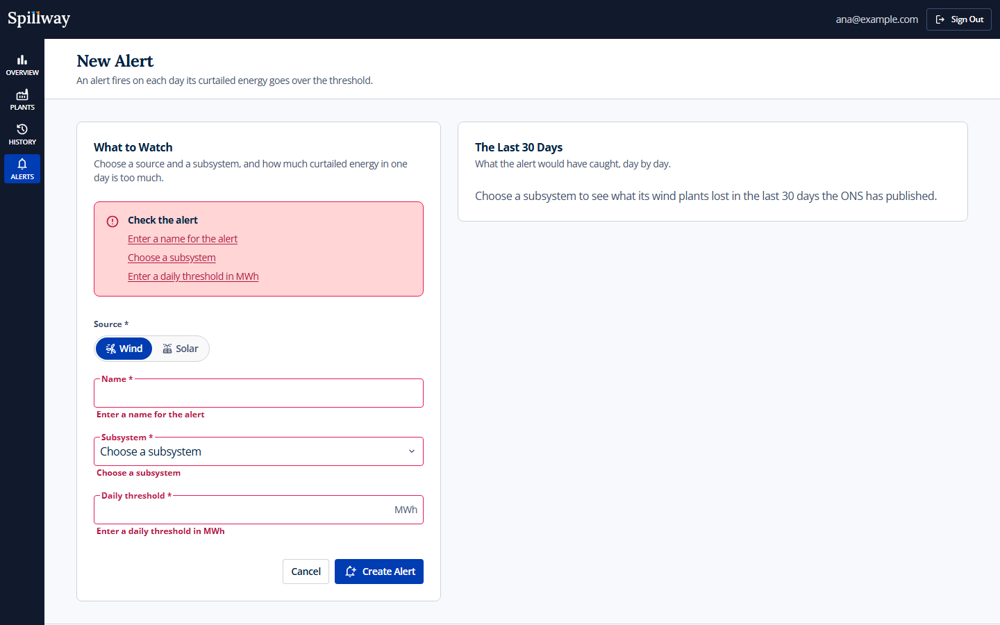

**A rule only the API can check**

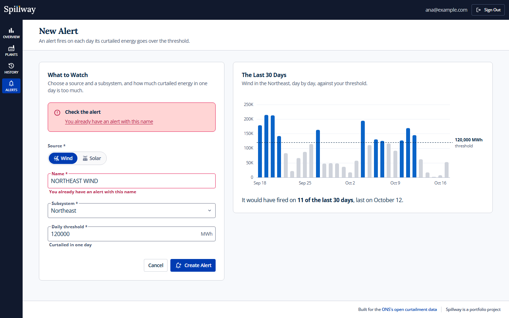

**No alerts yet**

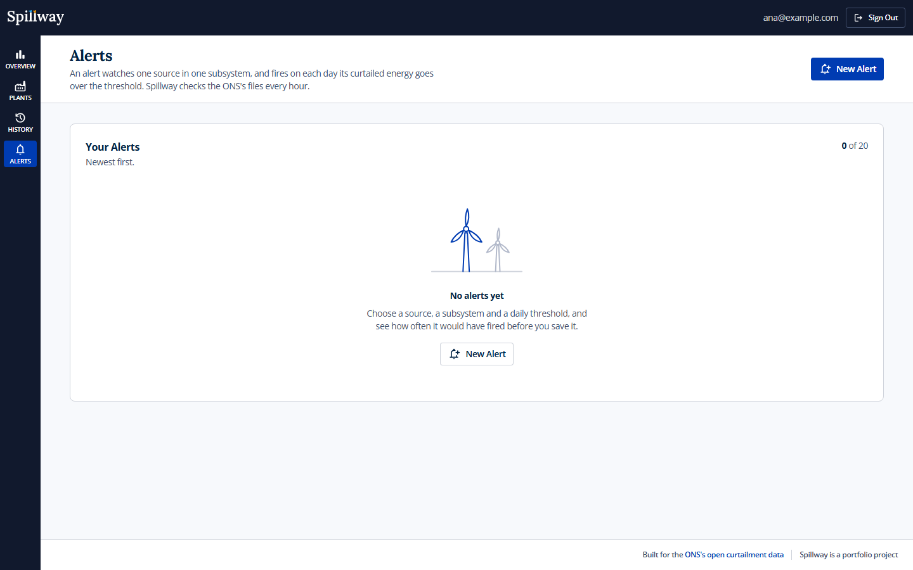

**On a phone**

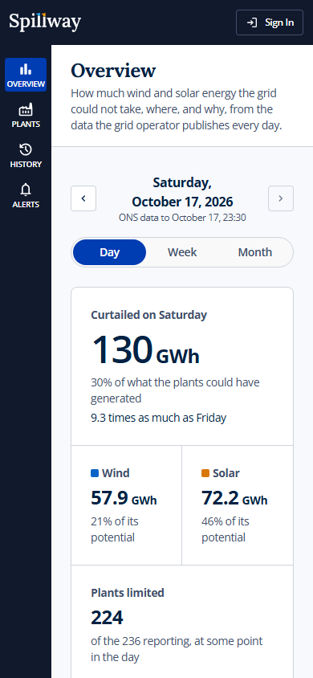

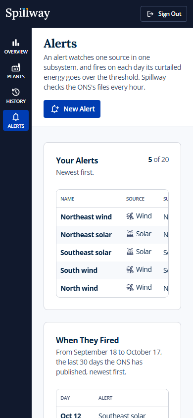

**A sign-in refused**

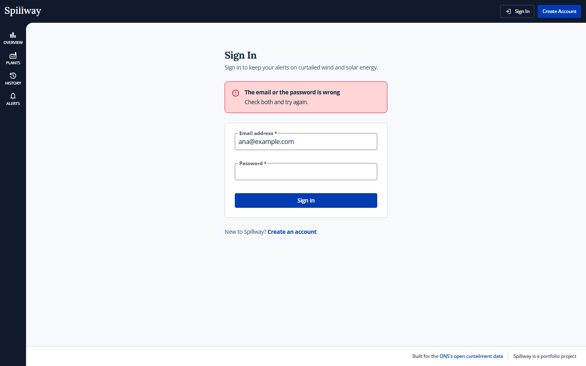

Regenerate with `pnpm run screenshots`, against the stack `docker compose up --wait --build` started, or with `pnpm run screenshots <name>` for one screen. They show the latest day the ONS has published, and the alerts are taken as an account of the script's own, `ana@example.com`, whose alerts it replaces each time.

</details>

---

## Setup

Docker, and nothing else. No API key or account.

```bash
docker compose up --wait --build
```

Then open `http://localhost:8090`. The first start downloads the ONS's files, about 280 MB, in a minute or so; until the latest month is in, the data pages say so. To keep alerts, sign up with any address: nothing is sent to it.

| Where | What |
| --- | --- |
| `http://localhost:8090` | The app. Use `localhost`: the app's origin is fixed when it is built, and a form posted from `127.0.0.1` is refused ([ADR 0015](docs/adr/0015-the-origin-is-fixed-at-build-time.md)) |
| `api:8080`, inside the stack | The Go API, which only the web server calls |
| `api:9090`, inside the stack | `/livez`, `/readyz` and `/metrics` |

```bash
docker compose exec web wget -qO- http://api:9090/metrics | grep '^ogen_server_request_count_total'
```

To work on it: pnpm 11 or newer, which switches itself to the pinned 12.14.0 and downloads Node 24.22 on the first `pnpm install`, and any Go from 1.21 on, which downloads Go 1.27.2 for itself.

---

## Why this data set

Most of Brazil's wind power, and much of its solar, is generated in the Northeast, and the lines that would carry all of it south are not built yet. When the grid cannot take what the plants could produce, the ONS, which operates the grid, orders them to hold back: curtailment, or constrained-off in the ONS's words.

The ONS publishes it on its open data portal under CC-BY, plant by plant in half-hour steps: wind since October 2021 and solar since April 2024, a Parquet file per source and month. It adds days to the current month's file as they come in and revises older ones as they are checked, so a day's figure can change after it first appears. Spillway loads a month again whenever its file changes, and works out an alert's firings from the data as it stands rather than recording them.

---

## Screens

| Route | What it is |
| --- | --- |
| `/` | A day, a week or a month against the one before: by half hour or by day, by subsystem and by reason, and the plants that lost the most |
| `/plants` | Every plant limited in a period, ranked by the energy it lost, by source and subsystem, twenty to a page |
| `/history` | Each month since the data begins, its share of what could have been generated, and each year |
| `/alerts` | The alerts, newest first and up to twenty, when each last fired, and the days they fired in the last thirty |
| `/alerts/new` | A new alert, with the last thirty days drawn against its threshold as it is typed |
| `/sign-up` | An account: an email address and a password of 15 characters or more |
| `/sign-in` | Signing in, and back to the page asked for |

---

## How it is built

- **A SvelteKit server in front, the domain in Go.** The browser only ever talks to SvelteKit, which renders every page and keeps the session in a cookie no script can read. The Go API owns the rules and the data, on a network no browser reaches ([ADR 0001](docs/adr/0001-a-sveltekit-server-in-front-of-a-go-api.md)).
- **The contract comes first.** Every request, answer, limit and error code is written once, in `contracts/openapi.yaml`. ogen generates the Go server, its validation and its telemetry; Hey API generates the TypeScript types, client and Zod schemas. CI fails when either side is stale, or when the contract would break a client ([ADR 0002](docs/adr/0002-the-contract-comes-first.md)).
- **Hexagonal, at Go's size.** Domain, use cases, adapters and platform, with interfaces declared where they are used and wired by hand in `main`. The lint fails when a dependency points outwards ([ADR 0003](docs/adr/0003-hexagonal-at-gos-size.md)).
- **One error vocabulary.** The domain names failures with sentinels and types; one function maps them, with `errors.Is` and `errors.As`, to RFC 9457 problems with a stable `code` and a JSON pointer per field, so the web puts each message next to its input ([ADR 0004](docs/adr/0004-errors-as-values-problems-at-the-edge.md)).
- **Rules checked twice.** The generated decoder holds every request to the contract, the domain's constructors hold it to the rules a schema cannot say, and a test keeps their limits equal ([ADR 0005](docs/adr/0005-validation-twice.md)).
- **Sessions no script can read.** An opaque token, stored only as its SHA-256, in an `HttpOnly`, `SameSite=Lax` cookie; argon2id for passwords, a throttle per address on sign-in, and the same answer and the same delay for an unknown address and a wrong password ([ADR 0006](docs/adr/0006-sessions-cookies-csrf-and-cors.md), [ADR 0007](docs/adr/0007-the-sign-in-throttle-lives-in-memory.md)).
- **Twenty alerts means twenty.** Creating one locks the account's row, counts and inserts in one transaction, and a test fires forty creates at once at a real Postgres to prove only twenty land ([ADR 0008](docs/adr/0008-the-alert-limit-is-held-by-the-database.md)).
- **Every form works without JavaScript.** Each is a plain form with a server action, enhanced when the script runs; a refused form comes back with what was typed, and an accepted one redirects, so a reload never posts it twice ([ADR 0010](docs/adr/0010-every-form-works-without-javascript.md)).
- **A dense look, accessible first.** Dark chrome, white panels, compact controls and tables, from tokens in Tailwind 4; every label visible, native selects and radios, one focus ring, an error summary that takes focus, toasts that wait to be closed ([ADR 0009](docs/adr/0009-a-dense-dashboard-look-accessibility-first.md)).
- **The ONS's files, synced on their own.** A second process from the same binary lists the ONS's bucket every hour, loads each new or revised month by its ETag, the latest first, and replaces it whole in one transaction. The pages read the sums it keeps, never the files ([ADR 0020](docs/adr/0020-the-ons-data-is-synced-by-a-process-of-its-own.md)).
- **Firings read from the data.** An alert's firings are a query over the daily sums, not rows of their own, so a revised day revises them too ([ADR 0021](docs/adr/0021-firings-are-read-from-the-data.md)).
- **Charts in our own SVG.** Columns, bars and lines are Svelte components on d3-scale, drawn on the server with no style attribute for the content security policy to refuse, and each chart's figures sit in a table under it ([ADR 0022](docs/adr/0022-charts-drawn-in-our-own-svg.md)).
- **Observable, and gentle when it stops.** slog with a request id from the browser's page to the API's log line, OpenTelemetry metrics for Prometheus and traces over OTLP, readiness that turns off before the server drains and stops ([ADR 0011](docs/adr/0011-observability.md), [ADR 0012](docs/adr/0012-graceful-shutdown-with-a-drain.md)).

---

## Testing

```bash
pnpm run ci              # format, lint, types, unit tests, and component tests in Chromium
pnpm run contract:check  # the web's generated client matches the contract
pnpm run e2e             # Playwright on a laptop, on a phone and with JavaScript off, against the stack and its data

cd services/api
go test -race ./...                                              # the API's unit tests
go test -race -tags integration ./internal/adapter/postgres/...  # against a real Postgres 18
```

The domain and the use cases are tested in memory, against fakes of their own interfaces, and the Postgres adapter against a real Postgres 18, forty creates at once for one account included, and a month loaded, read, revised and read again. The ONS adapter reads a Parquet file its test writes, from a test server that answers like the bucket. Vitest runs the components in Chromium. Playwright waits for the sync to load every month, then drives the whole stack as a visitor would: every state of every page audited by axe against WCAG 2.2 AA, no console error allowed, a content security policy report included, and every internal link followed.

CI runs the same, and golangci-lint with the layer rules, govulncheck, a check that generated code matches its sources, and oasdiff against the previous commit's contract. Then it builds the stack with compose and runs the browser checks against it.

---

## Reading further

[docs/architecture.md](docs/architecture.md) shows the pieces, the repository, one request from the form to the database and back, and the data from the ONS's files to a page. Each trade-off has a record in [docs/adr](docs/adr/README.md), version pins included, and [AGENTS.md](AGENTS.md) is how to work on the code.

---

## Licence

Code under MIT. The ONS's data, which Spillway is built for, is published under [CC-BY](https://dados.ons.org.br) on its open data portal.
